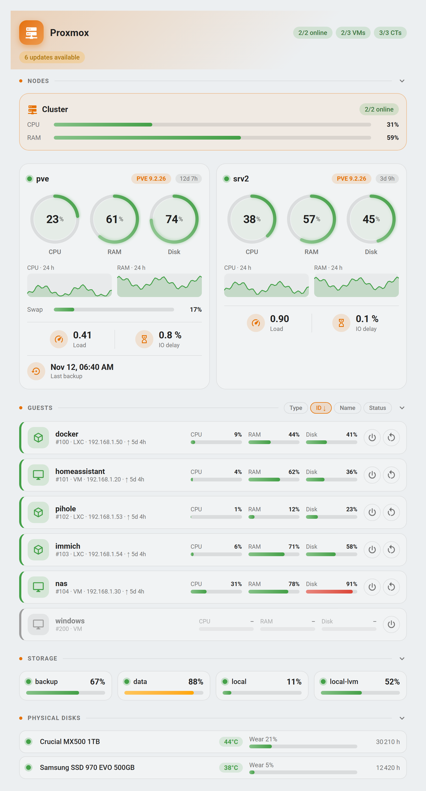
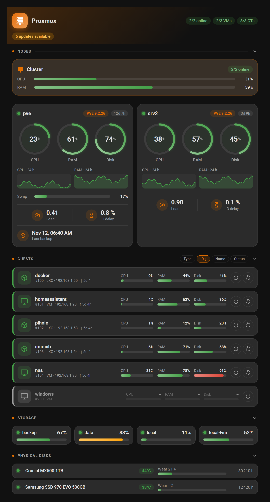
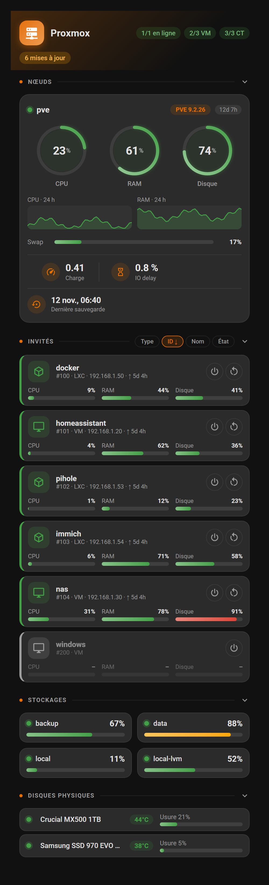

# ha-proxmox-card

[](https://hacs.xyz)
[](LICENSE)
[](https://github.com/aubierr/ha-proxmox-card/actions/workflows/validate.yml)

Carte Lovelace pour Home Assistant qui affiche votre infrastructure **Proxmox VE** : nœuds, machines virtuelles (QEMU) et conteneurs (LXC), avec jauges CPU / RAM / disque et boutons d'action.

Elle s'appuie sur l'intégration [**proxmoxve**](https://github.com/dougiteixeira/proxmoxve) de dougiteixeira : JavaScript pur, aucune dépendance (ni Mushroom, ni card-mod, ni button-card), thème clair/sombre automatique.

[](https://my.home-assistant.io/redirect/hacs_repository/?owner=aubierr&repository=ha-proxmox-card&category=plugin) **Ajouter la carte à HACS**

<p align="center">
  
  
</p>
<p align="center">
  
</p>

## Sommaire

- [Fonctionnalités](#fonctionnalités)
- [Prérequis](#prérequis)
- [Installation](#installation)
- [Configuration](#configuration)
- [Historique, sauvegarde et cluster](#historique-sauvegarde-et-cluster)
- [Filtrer et renommer les invités](#filtrer-et-renommer-les-invités)
- [Seuils des jauges](#seuils-des-jauges)
- [Quelles entités sont utilisées ?](#quelles-entités-sont-utilisées-)
- [Boutons d'action](#boutons-daction)
- [Dépannage](#dépannage)
- [Développement](#développement)
- [Licence](#licence)

## Fonctionnalités

- **Découverte automatique** : aucune entité à lister, la carte retrouve toutes les entités de l'intégration `proxmoxve`.
- **En-tête de synthèse** : nombre de nœuds en ligne, de VM et de conteneurs actifs (pastille orange ou rouge si un nœud est hors ligne).
- **Résumé du cluster** : avec 2 nœuds ou plus, une tuile « Cluster » (CPU et RAM globaux, nœuds en ligne, quorum perdu signalé).
- **Alertes** : pastilles sous l'en-tête, visibles seulement quand elles s'appliquent : mises à jour disponibles, sauvegarde en cours, tâches en échec, stockage inactif, disque en défaut.
- **Tuiles de nœuds** : statut, uptime, jauges circulaires CPU, RAM et disque, courbes d'historique CPU et RAM (24 h par défaut, lues dans l'historique de Home Assistant), barre de swap, puis une bande bien visible avec la charge système, l'IO delay (orange / rouge selon `thresholds.io`) et la date de la dernière sauvegarde (rouge si elle a échoué) ; la version de Proxmox s'affiche en pastille à côté du nom du nœud.
- **Liste des invités** (VM et LXC) : statut, nom, numéro, adresse IP, uptime, jauges CPU, RAM et disque, et badges (verrouillé, agent invité injoignable, problème signalé).
- **Tri des invités** : réglable dans la configuration (critère, sens, regroupement VM / LXC et ordre des groupes) et par boutons sur la carte (Type pour regrouper, puis ID / Nom / État ; un second clic sur le critère actif inverse le sens). Le choix fait avec les boutons est conservé jusqu'au rechargement de la page.
- **Sections repliables** : un clic sur le titre d'une section la replie (le choix est mémorisé dans le navigateur) ; `collapsed` règle l'état par défaut.
- **Mise en page** : les invités et les disques passent sur 2 colonnes quand la carte est large (`guest_columns`), couleur d'accent réglable (`accent`).
- **Léger** : la carte ne se met à jour que lorsqu'une des valeurs qu'elle affiche change, pas à chaque événement de la maison.
- **Filtres** : afficher seulement certains invités (`include`) ou en masquer (`exclude`), les renommer et changer leur icône (`guests`).
- **Stockages** : occupation de chaque stockage (local, LVM, partages…) et indicateur actif / inactif.
- **Disques physiques** : santé SMART, température, usure et heures de fonctionnement.
- **Jauges colorées** (circulaires pour les nœuds, barres dégradées ailleurs) : vert, orange, rouge selon des seuils réglables.
- **Boutons d'action** : démarrer, arrêter proprement, redémarrer, avec confirmation par second clic pour les actions risquées.
- **Fenêtre de détail** : un clic sur un nœud ou un invité ouvre la fiche (more-info) de son entité.
- **Responsive** : la mise en page s'adapte à la largeur de la carte (container queries) ; sur une carte étroite, les jauges des invités passent sous leur nom et les pastilles de l'en-tête sont masquées.
- **Éditeur visuel** intégré, avec des messages d'aide (combien d'invités ont des boutons, combien de stockages et de disques sont détectés) ; l'éditeur et l'interface traduits en **20 langues** (français, anglais, allemand, espagnol, italien, portugais, néerlandais, polonais, tchèque, suédois, danois, norvégien, finnois, russe, ukrainien, turc, roumain, hongrois, japonais, chinois), choisie automatiquement d'après Home Assistant.
- Respecte `prefers-reduced-motion`.

## Prérequis

- Home Assistant récent (2024.x ou plus ; la carte lit le registre d'entités et d'appareils exposé au frontend).
- L'intégration [proxmoxve](https://github.com/dougiteixeira/proxmoxve) installée et configurée ([ajouter dans HACS](https://my.home-assistant.io/redirect/hacs_repository/?owner=dougiteixeira&repository=proxmoxve&category=integration)) (la carte ne fonctionne pas avec l'intégration Proxmox « core » : elle cible la plateforme `proxmoxve`).

## Installation

### Via HACS (dépôt personnalisé)

En un clic (nécessite [My Home Assistant](https://my.home-assistant.io) configuré avec l'adresse de votre instance) :

[](https://my.home-assistant.io/redirect/hacs_repository/?owner=aubierr&repository=ha-proxmox-card&category=plugin)

Ou à la main :

1. HACS → menu ⋮ → **Dépôts personnalisés**.
2. Ajouter `https://github.com/aubierr/ha-proxmox-card`, type **Tableau de bord** (Dashboard / Lovelace).
3. Installer **Proxmox Card**, puis recharger le navigateur (Ctrl+F5).

### Manuelle

1. Copier [`dist/proxmox-card.js`](dist/proxmox-card.js) dans `/config/www/`.
2. Réglages → Tableaux de bord → ⋮ → **Ressources** → **Ajouter une ressource** :
   - URL : `/local/proxmox-card.js`
   - Type : **Module JavaScript**
3. Recharger le navigateur.

## Configuration

Ajoutez la carte depuis l'éditeur visuel (« Proxmox Card ») ou en YAML :

```yaml
type: custom:proxmox-card
title: Proxmox
```

Exemple complet :

```yaml
type: custom:proxmox-card
title: Homelab
node: pve                # ne garder que les appareils dont le nom contient "pve"
show_nodes: true
show_qemu: true
show_lxc: true
show_stopped: true
show_actions: true
show_ip: true
show_uptime: true
show_badges: true
show_alerts: true
show_storage: true
show_disks: true
show_swap: true
show_load: true
show_version: true
show_sort: true
sort: id                 # id | name | status
sort_dir: asc            # asc | desc
group_by_type: false     # true = VM puis LXC (ou l'inverse avec type_order)
type_order: vm_first     # vm_first | lxc_first
show_cluster: true       # résumé du cluster à partir de 2 nœuds
show_history: true       # courbes d'historique CPU / RAM des nœuds
history_hours: 24        # période : 6, 12, 24, 48 ou 72
show_backup: true        # date de la dernière sauvegarde
guest_columns: auto      # auto (2 colonnes si large) | 1 | 2
collapsed: [disks]       # sections repliées par défaut : nodes, guests, storage, disks
accent: "#1e88e5"         # couleur d'accent (n'importe quelle couleur CSS)
exclude: [openwrt, "120"]   # masquer ces invités (ID ou nom)
# include: [100, docker]    # ou n'afficher que ceux-là
guests:                     # nom et icône personnalisés (clé = ID ou nom)
  "104": { name: Routeur, icon: mdi:router-wireless }
language: fr
thresholds:
  cpu:         { warning: 60, critical: 85 }
  memory:      { warning: 80, critical: 95 }
  disk:        { warning: 80, critical: 90 }
  temperature: { warning: 55, critical: 70 }
  wear:        { warning: 70, critical: 90 }
  io:          { warning: 5,  critical: 15 }
```

| Option | Type | Défaut | Description |
|---|---|---|---|
| `title` | texte | `Proxmox` | Titre de la carte |
| `node` | texte | *(vide)* | Filtre : ne garde que les nœuds, VM et conteneurs dont le nom d'appareil (ou celui de l'appareil parent) contient ce texte, sans tenir compte de la casse |
| `show_nodes` | booléen | `true` | Afficher les tuiles de nœuds |
| `show_qemu` | booléen | `true` | Afficher les machines virtuelles |
| `show_lxc` | booléen | `true` | Afficher les conteneurs LXC |
| `show_stopped` | booléen | `true` | Afficher aussi les invités arrêtés (atténués) |
| `show_actions` | booléen | `true` | Afficher les boutons d'action |
| `show_ip` | booléen | `true` | Afficher l'adresse IP de l'invité |
| `show_uptime` | booléen | `true` | Afficher l'uptime des invités qui tournent |
| `show_badges` | booléen | `true` | Badges sur les invités : verrouillé, agent invité injoignable, problème signalé |
| `show_alerts` | booléen | `true` | Pastilles d'alerte (mises à jour, sauvegarde, tâches en échec, stockage inactif, disque en défaut) |
| `show_storage` | booléen | `true` | Section des stockages |
| `show_disks` | booléen | `true` | Section des disques physiques (SMART) |
| `show_swap` | booléen | `true` | Jauge de swap sur les nœuds |
| `show_load` | booléen | `true` | Charge système et IO delay sur les nœuds |
| `show_version` | booléen | `true` | Version de Proxmox VE sur les nœuds |
| `show_sort` | booléen | `true` | Boutons de tri (Type, ID, Nom, État) dans l'en-tête de la section des invités |
| `sort` | texte | `id` | Critère de tri des invités : `id`, `name` ou `status` (actifs d'abord) |
| `sort_dir` | texte | `asc` | Sens du tri : `asc` (croissant, du haut vers le bas ↓) ou `desc` (décroissant, du bas vers le haut ↑) |
| `group_by_type` | booléen | `false` | Regrouper les VM et les conteneurs LXC ; le critère s'applique à l'intérieur de chaque groupe |
| `type_order` | texte | `vm_first` | Ordre des groupes quand ils sont regroupés : `vm_first` (VM puis LXC) ou `lxc_first` |
| `show_cluster` | booléen | `true` | Tuile de résumé du cluster (affichée à partir de 2 nœuds) |
| `show_history` | booléen | `true` | Courbes d'historique CPU et RAM sur les nœuds |
| `history_hours` | nombre | `24` | Période des courbes en heures : `6`, `12`, `24`, `48` ou `72` |
| `show_backup` | booléen | `true` | Date de la dernière sauvegarde du nœud (entité « Last backup », désactivée par défaut dans l'intégration) |
| `guest_columns` | texte | `auto` | Colonnes de la liste des invités et des disques : `auto` (2 colonnes si la carte fait au moins 900 px), `1` ou `2` |
| `collapsed` | liste | *(vide)* | Sections repliées par défaut : `nodes`, `guests`, `storage`, `disks` |
| `accent` | texte ou RVB | orange Proxmox | Couleur d'accent : couleur CSS (`"#1e88e5"`, `teal`…) ou liste `[r, g, b]` du sélecteur de couleur |
| `include` | liste | *(vide)* | N'afficher que ces invités (ID ou nom). Vide = tous |
| `exclude` | liste | *(vide)* | Masquer ces invités (ID ou nom) |
| `guests` | objet | *(vide)* | Nom (`name`) et icône (`icon`) personnalisés par invité, voir ci-dessous (YAML uniquement) |
| `thresholds` | objet | voir ci-dessous | Seuils `warning` / `critical` par jauge |
| `language` | texte | `auto` | `auto` (langue de Home Assistant) ou un code : `en`, `fr`, `de`, `es`, `it`, `pt`, `nl`, `pl`, `cs`, `sv`, `da`, `nb`, `fi`, `ru`, `uk`, `tr`, `ro`, `hu`, `ja`, `zh` |

## Historique, sauvegarde et cluster

- **Courbes d'historique** : la carte interroge l'historique (*recorder*) de Home Assistant pour les entités CPU et RAM de chaque nœud, puis se rafraîchit toutes les 5 minutes. Si l'historique de ces entités est exclu du *recorder*, les courbes n'apparaissent pas ; `show_history: false` les retire.
- **Dernière sauvegarde** : elle vient de l'entité « Last backup » du nœud, **désactivée par défaut** dans l'intégration (Paramètres → Appareils et services → le nœud → entités désactivées). Activez aussi « Backup status » pour être alerté d'un échec. L'éditeur indique si l'entité est absente.
- **Cluster** : la tuile s'affiche quand le cluster compte au moins 2 nœuds, à partir des entités de l'appareil « Proxmox Cluster » ; une perte de quorum (entité d'état de haute disponibilité de l'intégration, si elle est configurée) est signalée.

## Filtrer et renommer les invités

```yaml
type: custom:proxmox-card
exclude:
  - openwrt        # par nom (ou une partie du nom)
  - "120"          # par ID
guests:
  "104":           # clé = ID ou nom exact
    name: Routeur
    icon: mdi:router-wireless
  docker:
    icon: mdi:docker
```

- Une entrée **numérique** correspond à l'ID exact ; une entrée **texte** correspond au nom exact, ou à une partie du nom (sans tenir compte de la casse).
- `include` et `exclude` s'appliquent partout : liste, compteurs de l'en-tête et tri. Si les deux sont renseignés, `exclude` l'emporte.
- `include` et `exclude` se règlent aussi dans l'éditeur visuel (section « Filtres »). Le renommage et les icônes (`guests`) se font en YAML.
- Le tri par nom utilise le nom affiché, donc le nom personnalisé.

## Seuils des jauges

| Jauge | Orange à partir de | Rouge à partir de |
|---|---|---|
| `cpu` | 70 % | 90 % |
| `memory` | 80 % | 95 % |
| `disk` (nœuds, invités, stockages) | 80 % | 90 % |
| `temperature` (disques physiques) | 55 °C | 70 °C |
| `wear` (usure des disques) | 70 % | 90 % |
| `io` (IO delay des nœuds) | 5 % | 15 % |

Vous pouvez ne surcharger qu'une partie des valeurs ; le reste garde sa valeur par défaut.

## Quelles entités sont utilisées ?

La carte parcourt les entités dont la plateforme est `proxmoxve`, les regroupe par appareil, puis reconnaît leur rôle grâce à leur clé de traduction ou à leur identifiant :

| Appareil | Rôles lus |
|---|---|
| **Nœud** | statut, CPU, mémoire (% ou utilisée / totale), disque (% ou utilisé / total), swap, uptime, charge 1 min, IO delay, version, mise à jour disponible et nombre de mises à jour, sauvegarde en cours, tâches en échec |
| **VM (QEMU)** et **conteneur (LXC)** | statut, CPU, mémoire, disque, adresse IP, uptime, verrouillé, agent invité, santé, boutons start / shutdown / reboot / stop |
| **Stockage** (`Storage nœud/nom`) | disque utilisé (%), stockage actif |
| **Disque physique** (`Disk nœud: modèle`) | santé, température, usure (ou vie restante), heures de fonctionnement |

Le type d'appareil est déterminé d'après son nom et son modèle (`Node …`, `QEMU … (109)`, `LXC … (516)`, `Storage …`, `Disk …`). Le numéro entre parenthèses devient le VMID affiché.

> **Important** : une partie des entités de l'intégration est **désactivée par défaut** (mémoire, boutons, etc.). Si une jauge affiche « – » ou si les boutons manquent, activez l'entité concernée : Réglages → Appareils et services → *Proxmox VE* → l'appareil → entités désactivées → ⚙ → **Activer**, puis rechargez l'intégration si nécessaire.

## Boutons d'action

| Bouton | Visible si | Entité utilisée |
|---|---|---|
| Démarrer | l'invité est arrêté | bouton « Start » |
| Arrêter (shutdown) | l'invité tourne | bouton « Shutdown » |
| Redémarrer | l'invité tourne | bouton « Reboot » |
| Forcer l'arrêt | l'invité tourne et le bouton « Shutdown » n'existe pas | bouton « Stop » |

Les actions **Arrêter**, **Redémarrer** et **Forcer l'arrêt** demandent un **second clic** dans les 4 secondes (le bouton devient rouge). **Démarrer** s'exécute directement.

Côté Proxmox, l'utilisateur de l'intégration doit avoir le privilège `VM.PowerMgmt` ; sans lui, les boutons ne sont pas créés par l'intégration.

Pour masquer tous les boutons : `show_actions: false`.

> Les sections et informations sans entité correspondante (par exemple pas de disques SMART, pas d'agent invité) n'apparaissent simplement pas.

## Dépannage

| Symptôme | Cause probable / solution |
|---|---|
| « Aucune entité Proxmox trouvée » | L'intégration `proxmoxve` n'est pas installée, ou aucun nœud / invité n'est suivi dans ses options |
| La carte n'apparaît pas dans le sélecteur | Ressource non ajoutée ou cache : vérifier `/local/proxmox-card.js` (type module) et faire Ctrl+F5 |
| Jauge RAM ou disque à « – » | Entité de mémoire / disque désactivée par défaut : l'activer (voir plus haut). Un conteneur arrêté remonte son disque en « inconnu » |
| Pas de boutons | Entités `button.*` désactivées, ou privilège `VM.PowerMgmt` manquant côté Proxmox. L'éditeur visuel l'indique sous l'option « Boutons marche / arrêt » (« 6 invités sur 6 ont des boutons… » ou « Aucun bouton trouvé… ») |
| Un invité manque | Les modèles (templates) ne sont jamais suivis ; vérifier aussi `node` et `show_stopped` |
| Pas d'IP affichée | Capteur « IP address » absent : nécessite l'agent invité (VM) ou les droits `VM.Audit` (LXC) |
| Mauvais capteur reconnu | [Ouvrez une issue](https://github.com/aubierr/ha-proxmox-card/issues/new/choose) : le modèle fournit un script qui liste vos entités `proxmoxve` (nom, clé de traduction, `entity_id`) |

## Développement

Le projet est un unique fichier JavaScript sans étape de build : [`dist/proxmox-card.js`](dist/proxmox-card.js).

Une page de test avec un faux objet `hass` est fournie dans [`test/`](test/index.html). Les modules ES ne se chargent pas depuis `file://`, il faut donc un petit serveur :

```bash
python -m http.server 8765
# puis ouvrir http://localhost:8765/test/index.html
```

Paramètres de la page de test : `?lang=en` (langue), `?theme=dark`, `?w=560` (largeur de la carte en px), `?single=1` (une seule carte), `?shot=1` (sans bouton, pour les captures). Les icônes sont chargées depuis Internet (jsDelivr).

Les captures du README (`docs/screenshots/`) sont générées depuis cette page avec Edge ou Chrome en mode headless :

```bash
msedge --headless=new --hide-scrollbars --force-device-scale-factor=2 --window-size=800,1210   --virtual-time-budget=12000 --screenshot=docs/screenshots/card-light.png   "http://localhost:8765/test/index.html?lang=en&single=1&w=760&shot=1"
```

### Vérifications automatiques

Le workflow [`validate.yml`](.github/workflows/validate.yml) s'exécute à chaque *push* et chaque semaine :

- **HACS** : validation officielle du dépôt ([hacs/action](https://github.com/hacs/action)) ;
- **JavaScript** : vérification de la syntaxe du module ;
- **Traductions** : `node test/check-i18n.mjs` vérifie que les 20 langues de la carte et de l'éditeur sont complètes.

## Remerciements

- [dougiteixeira/proxmoxve](https://github.com/dougiteixeira/proxmoxve) pour l'intégration Proxmox VE.

## Licence

[MIT](LICENSE)
