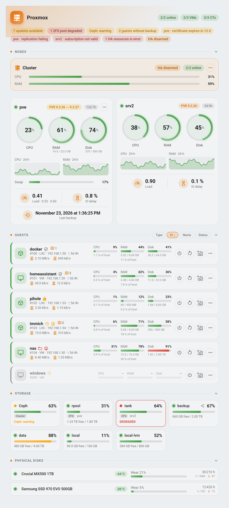
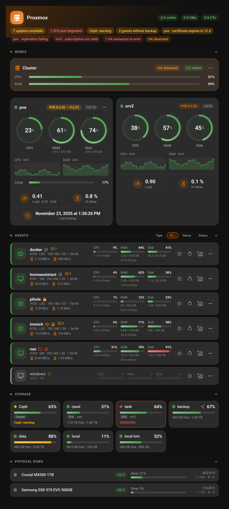
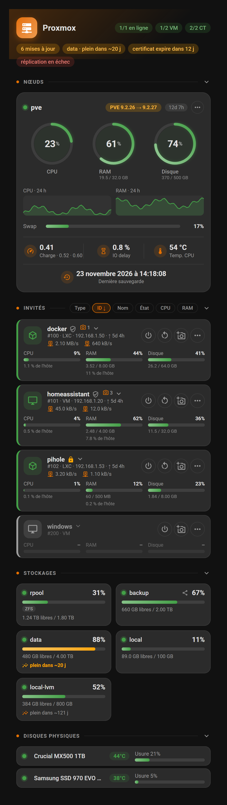

# ha-proxmox-card

**English** · [Français](README.fr.md)

[](https://hacs.xyz)
[](LICENSE)
[](https://github.com/aubierr/ha-proxmox-card/actions/workflows/validate.yml)

A Lovelace card for Home Assistant that shows your **Proxmox VE** infrastructure: nodes, virtual machines (QEMU) and containers (LXC), with CPU / RAM / disk gauges and action buttons.

It is built on dougiteixeira's [**Proxmox VE Custom**](https://github.com/dougiteixeira/proxmoxve) integration (domain `proxmoxve_custom` since 6.0): plain JavaScript, no dependencies (no Mushroom, card-mod or button-card), automatic light / dark theme.

[](https://my.home-assistant.io/redirect/hacs_repository/?owner=aubierr&repository=ha-proxmox-card&category=plugin) **Add the card to HACS**

<p align="center">
  
  
</p>
<p align="center">
  
</p>

## Contents

- [Features](#features)
- [Requirements](#requirements)
- [Installation](#installation)
- [Configuration](#configuration)
- [History, backup and cluster](#history-backup-and-cluster)
- [Sizes, pressure and snapshots](#sizes-pressure-and-snapshots)
- [Network in and out](#network-in-and-out)
- [ZFS, Ceph, backups, certificate, subscription, replication and HA](#zfs-ceph-backups-certificate-subscription-replication-and-ha)
- [Backups](#backups)
- [Filtering and renaming guests](#filtering-and-renaming-guests)
- [Single-guest card](#single-guest-card)
- [Gauge thresholds](#gauge-thresholds)
- [Colours and themes](#colours-and-themes)
- [Which entities are used?](#which-entities-are-used)
- [Action buttons](#action-buttons)
- [Troubleshooting](#troubleshooting)
- [Development](#development)
- [License](#license)

## Features

- **Automatic discovery**: no entity to list, the card finds every entity of the `proxmoxve_custom` integration (or `proxmoxve` before version 6.0 of the integration).
- **Summary header**: nodes online, running VMs and containers (orange or red pill when a node is offline).
- **Cluster summary**: with 2 nodes or more, a "Cluster" tile (overall CPU and RAM, nodes online, lost quorum flagged).
- **Alerts**: pills under the header, shown only when they apply: updates available, backup running, failed tasks, inactive storage, failing disk, degraded ZFS pool, Ceph warning or error, guests without backup, certificate about to expire, invalid subscription, storage filling up. Clicking a pill opens the entity behind it.
- **Node tiles**: status, uptime, CPU / RAM / disk ring gauges, CPU and RAM history curves (24 h by default, read from Home Assistant's history), swap bar, then a strip with the system load (1 min, plus 5 / 15 min when those sensors are enabled), the IO delay (orange / red according to `thresholds.io`), the CPU temperature (hardware sensors, `thresholds.cpu_temperature`) and the date of the last backup (red when it failed); the Proxmox version shows as a pill next to the node name, with the new release when one is available.
- **Guest list** (VMs and LXC): status, name, ID, node (on a cluster), IP address, uptime, CPU / RAM / disk gauges, share of the host used ("3.9 % of host"), and badges (locked, guest agent not responding, problem reported, replication failing).
- **Real sizes**: free and total space of the storages, used / total memory and disk of the nodes and guests (shown, or on hover).
- **Pressure**: orange or red badge on a guest whose CPU, memory or IO are saturated (Proxmox PSI metrics).
- **Snapshots**: number of snapshots of each guest and a button to take one (with confirmation).
- **Network per guest**: throughput in and out (or the total since start) under each running guest, in bytes or bits per second.
- **Guest sorting**: set in the configuration (criterion, direction, VM / LXC grouping and group order) and with buttons on the card (Type and Node to group, then ID / Name / Status / CPU / RAM; CPU and RAM put the busiest first; a second click on the active criterion reverses it). The choice made with the buttons lasts until the page is reloaded.
- **Collapsible sections**: clicking a section title folds it (remembered in the browser); `collapsed` sets the default.
- **Layout**: guests and disks switch to 2 columns when the card is wide (`guest_columns`), adjustable accent colour (`accent`), adjustable section order (`section_order`).
- **Backups**: date, duration and verdict of each node's last backup, alert when it gets too old (the schedule may have stopped), backup in progress with its guests and duration (animated badge on those guests), a "Backups" section, and backups started by the card on the storage of your choice (see [Backups](#backups)).
- **Fill forecast**: from the last 7 days of history, every storage, ZFS pool and Ceph that is filling up shows "full in ~23 d", with an alert pill as the date gets close.
- **Search and "Problems" filter**: from 6 guests, a search field (name or ID) and a button that keeps only the guests with an alert.
- **Guest detail**: the chevron next to the name unfolds its CPU, RAM and network curves (in / out, with the peak of the period) and its alerts spelled out.
- **Single-guest card** (`custom:proxmox-guest-card`): the tile of one VM or container, to place anywhere (see below).
- **Compact mode** (`compact`): bars instead of rings, no curves, for small dashboards.
- **Keyboard accessible**: tiles and pills reachable with Tab and opened with Enter; icon buttons are named for screen readers.
- **Light**: the card only updates when one of the values it shows changes, not on every event in the house; the entity classification is cached until the registry changes.
- **Themes**: colours adjustable from a Home Assistant theme (see [Colours and themes](#colours-and-themes)).
- **Filters**: show only some guests (`include`) or hide some (`exclude`), rename them and change their icon (`guests`).
- **Storage**: usage of every storage (local, LVM, shares…) and an active / inactive indicator, plus **ZFS pools** (state `ONLINE`, `DEGRADED`…) and **Ceph** (cluster health and usage).
- **Physical disks**: SMART health, temperature, wear, power-on hours, power cycles (↻) and unsafe shutdowns (⚡).
- **Coloured gauges** (rings for the nodes, gradient bars elsewhere): green, orange, red according to adjustable thresholds.
- **Action buttons**: start, shut down, reboot, with a second click to confirm risky actions; a "⋯" menu for the other actions of guests (suspend, resume, hibernate, reset, back up, unlock), nodes (start / stop / suspend / back up all guests, reboot, shut down, Wake-on-LAN) and the cluster (arm / disarm HA).
- **Detail dialog**: clicking a node or a guest opens its entity's more-info dialog, or another action with `tap_action` (go to a dashboard, open a URL…). "⋯" menus close with Escape or a click outside.
- **Responsive**: the layout follows the width of the card (container queries); on a narrow card the guest gauges move under the name and the header pills are hidden.
- **Visual editor** with help messages (how many guests have buttons, how many storages and disks were found, which entities to enable) and a **Copy the diagnostic** button; the editor and the card are translated into **20 languages** (English, French, German, Spanish, Italian, Portuguese, Dutch, Polish, Czech, Swedish, Danish, Norwegian, Finnish, Russian, Ukrainian, Turkish, Romanian, Hungarian, Japanese, Chinese), picked from Home Assistant automatically.
- Respects `prefers-reduced-motion`.

## Requirements

- A recent Home Assistant (2024.x or later; the card reads the entity and device registry exposed to the frontend).
- The [Proxmox VE Custom](https://github.com/dougiteixeira/proxmoxve) integration installed and configured, preferably version 6.0 or later ([add to HACS](https://my.home-assistant.io/redirect/hacs_repository/?owner=dougiteixeira&repository=proxmoxve&category=integration)). The card does not work with Home Assistant's built-in Proxmox VE integration.

### Integration 6.0: domain change

Since version 6.0 the integration is called **Proxmox VE Custom** and its domain changed from `proxmoxve` to `proxmoxve_custom` (so it can live next to Home Assistant's built-in Proxmox VE integration, which uses `proxmoxve`). The card follows the change by itself:

- when `proxmoxve_custom` entities exist, the card uses only them and ignores the built-in integration's, even when both are installed;
- otherwise it reads the `proxmoxve` entities (integration 5.x, not migrated yet).

No change to the card's configuration is needed. Migrating the integration itself is described in its [6.0 release notes](https://github.com/dougiteixeira/proxmoxve/releases/tag/6.0.1) (backup, 6.0.0b0 transition release, then reinstallation).

## Installation

### With HACS (custom repository)

In one click (needs [My Home Assistant](https://my.home-assistant.io) set up with the address of your instance):

[](https://my.home-assistant.io/redirect/hacs_repository/?owner=aubierr&repository=ha-proxmox-card&category=plugin)

Or by hand:

1. HACS → ⋮ menu → **Custom repositories**.
2. Add `https://github.com/aubierr/ha-proxmox-card`, type **Dashboard** (Lovelace).
3. Install **Proxmox Card**, then reload the browser (Ctrl+F5).

### Manual

1. Copy [`dist/proxmox-card.js`](dist/proxmox-card.js) to `/config/www/`.
2. Settings → Dashboards → ⋮ → **Resources** → **Add resource**:
   - URL: `/local/proxmox-card.js`
   - Type: **JavaScript module**
3. Reload the browser.

## Configuration

Add the card from the visual editor ("Proxmox Card") or in YAML:

```yaml
type: custom:proxmox-card
title: Proxmox
```

Full example:

```yaml
type: custom:proxmox-card
title: Homelab
node: pve                # keep only the devices whose name contains "pve"
show_nodes: true
show_qemu: true
show_lxc: true
show_stopped: true
show_actions: true
show_ip: true
show_uptime: true
show_badges: true
show_alerts: true
show_storage: true
show_disks: true
show_swap: true
show_load: true
show_version: true
show_sort: true
sort: id                 # id | name | status | cpu | mem
sort_dir: asc            # asc | desc
group_by_type: false     # true = VMs then LXC (or the other way round with type_order)
group_by_node: false     # true = guests grouped by node (clusters)
type_order: vm_first     # vm_first | lxc_first
show_cluster: true       # cluster summary from 2 nodes
show_history: true       # CPU / RAM history curves of the nodes
history_hours: 24        # period: 6, 12, 24, 48 or 72
show_backup: true        # date of the last backup
show_network: true       # network in / out of each guest
show_sizes: true         # sizes (free / total, used / total)
show_pressure: true      # CPU / memory / IO pressure badge
show_snapshots: true     # snapshot count and "create" button
show_host_share: true    # share of the host used by each guest
show_temperature: true   # node CPU temperature (hardware sensors)
show_forecast: true      # storage fill forecast
show_filter_bar: true    # search and "Problems" filter (from 6 guests)
compact: false           # compact mode
show_backup_section: true   # "Backups" section
backup:                  # backups started by the card ("⋯" menus)
  storage: pbs           # Proxmox storage ID
  mode: snapshot         # snapshot | suspend | stop
network_mode: rate       # rate (per second) | total (since start)
network_unit: bytes      # bytes (kB/s, MB/s…) | bits (kbit/s, Mbit/s…)
guest_columns: auto      # auto (2 columns when wide) | 1 | 2
collapsed: [disks]       # sections folded by default: nodes, guests, storage, disks
section_order: [guests, nodes]   # these sections first, the others after them
tap_action:              # action when a tile is clicked (default: the entity's dialog)
  action: navigate
  navigation_path: /dashboard-proxmox
accent: "#1e88e5"         # accent colour (any CSS colour)
exclude: [openwrt, "120"]   # hide these guests (ID or name)
# include: [100, docker]    # or show only those
guests:                     # custom name and icon (key = ID or name)
  "104": { name: Router, icon: mdi:router-wireless }
language: en
thresholds:
  cpu:         { warning: 60, critical: 85 }
  memory:      { warning: 80, critical: 95 }
  disk:        { warning: 80, critical: 90 }
  temperature: { warning: 55, critical: 70 }
  wear:        { warning: 70, critical: 90 }
  io:          { warning: 5,  critical: 15 }
  pressure:    { warning: 10, critical: 30 }
  certificate: { warning: 30, critical: 7 }   # days before expiry
  cpu_temperature: { warning: 75, critical: 90 }   # °C
  forecast:    { warning: 30, critical: 7 }    # days before a storage is full
  backup_age:  { warning: 26, critical: 50 }   # hours since a node's last backup
```

| Option | Type | Default | Description |
|---|---|---|---|
| `title` | text | `Proxmox` | Card title |
| `node` | text | *(empty)* | Filter: keeps only the nodes, VMs and containers whose device name (or parent device name) contains this text, case-insensitive |
| `show_nodes` | boolean | `true` | Show the node tiles |
| `show_qemu` | boolean | `true` | Show the virtual machines |
| `show_lxc` | boolean | `true` | Show the LXC containers |
| `show_stopped` | boolean | `true` | Also show stopped guests (dimmed) |
| `show_actions` | boolean | `true` | Show the action buttons |
| `show_ip` | boolean | `true` | Show the guest's IP address |
| `show_uptime` | boolean | `true` | Show the uptime of running guests |
| `show_badges` | boolean | `true` | Guest badges: locked, guest agent not responding, problem reported |
| `show_alerts` | boolean | `true` | Alert pills (updates, backup, failed tasks, inactive storage, failing disk, ZFS, Ceph, guests without backup, certificate, subscription, forecast) |
| `show_storage` | boolean | `true` | Storage section (with ZFS pools and Ceph) |
| `show_disks` | boolean | `true` | Physical disks section (SMART) |
| `show_swap` | boolean | `true` | Swap gauge on the nodes |
| `show_load` | boolean | `true` | System load and IO delay on the nodes |
| `show_version` | boolean | `true` | Proxmox VE version on the nodes, with the new release when available ("PVE 9.2.26 → 9.2.27") |
| `show_sort` | boolean | `true` | Sort buttons in the header of the guest section |
| `sort` | text | `id` | Guest sort: `id`, `name`, `status` (running first), `cpu` or `mem` (busiest first, stopped guests last) |
| `sort_dir` | text | `asc` | Direction: `asc` (ascending, top to bottom ↓) or `desc` (descending ↑) |
| `group_by_node` | boolean | `false` | Group the guests by node, with a heading per node (clusters of 2 nodes or more). Without grouping, the node shows in each guest's detail line |
| `group_by_type` | boolean | `false` | Group VMs and LXC containers; the sort applies inside each group |
| `type_order` | text | `vm_first` | Group order when grouped: `vm_first` (VMs then LXC) or `lxc_first` |
| `show_cluster` | boolean | `true` | Cluster summary tile (from 2 nodes) |
| `show_history` | boolean | `true` | CPU and RAM history curves on the nodes (and in a guest's detail) |
| `history_hours` | number | `24` | Curve period in hours: `6`, `12`, `24`, `48` or `72` |
| `show_backup` | boolean | `true` | Date of the node's last backup ("Last backup" entity, disabled by default in the integration) |
| `show_network` | boolean | `true` | Network in and out under each running guest ("Network in / out" entities, disabled by default) |
| `network_mode` | text | `rate` | `rate`: throughput per second, computed by the card; `total`: volume since the guest started |
| `network_unit` | text | `bytes` | Throughput unit: `bytes` (kB/s, MB/s…) or `bits` (kbit/s, Mbit/s…) |
| `show_sizes` | boolean | `true` | Real sizes: "660 GB free / 2.00 TB" on storages, "19.5 / 32 GB" under node and guest gauges |
| `show_pressure` | boolean | `true` | Pressure badge (CPU, memory or IO) on guests above `thresholds.pressure` |
| `show_snapshots` | boolean | `true` | Snapshot count of the guest and "Create snapshot" button (second click to confirm) |
| `show_forecast` | boolean | `true` | Fill forecast of storages, ZFS pools and Ceph: slope of the usage over 7 days of history, shown when the storage would be full within a year. Alert pill according to `thresholds.forecast` |
| `show_filter_bar` | boolean | `true` | Search field (name or ID) and "Problems" button above the guests, from 6 guests. Escape clears the search |
| `show_backup_section` | boolean | `true` | "Backups" section: last run of each node, run in progress, guests without backup (needs `show_backup`) |
| `backup` | object | *(empty)* | `storage` (Proxmox storage ID) and `mode` (`snapshot`, `suspend`, `stop`): "Back up now" and "Back up all guests" then use the integration's `proxmoxve_custom.backup` action on this storage, see [Backups](#backups) |
| `compact` | boolean | `false` | Compact mode: bars instead of rings on the nodes, no curves or secondary lines (network, sizes, host share) |
| `show_temperature` | boolean | `true` | Node CPU temperature in the load / IO delay strip; the other temperature sensors on hover. Needs the integration's hardware sensors (PVE-mods and lm-sensors on the host) |
| `show_host_share` | boolean | `true` | Share of the host's CPU and RAM used by each guest, under its gauges ("CPU used of host" and "Memory used of host" entities, disabled by default) |
| `guest_columns` | text | `auto` | Columns of the guest and disk lists: `auto` (2 columns when the card is at least 900 px wide), `1` or `2` |
| `collapsed` | list | *(empty)* | Sections folded by default: `nodes`, `guests`, `storage`, `disks` |
| `section_order` | list | *(empty)* | Section order: the listed ones first, the others after them in the default order (nodes, guests, storage, disks). To hide a section, use `show_*` |
| `tap_action` | action | entity dialog | Action when a tile (node, guest, storage, disk) is clicked: a standard Home Assistant action (`navigate`, `url`, `perform-action`, `none`…). Pills (alerts, version, HA) always open their entity |
| `accent` | text or RGB | Proxmox orange | Accent colour: a CSS colour (`"#1e88e5"`, `teal`…) or the `[r, g, b]` list of the colour picker |
| `include` | list | *(empty)* | Show only these guests (ID or name). Empty = all |
| `exclude` | list | *(empty)* | Hide these guests (ID or name) |
| `guests` | object | *(empty)* | Custom name (`name`) and icon (`icon`) per guest, see below; also in the visual editor ("Guest names and icons") |
| `thresholds` | object | see below | `warning` / `critical` thresholds per gauge, also in the visual editor ("Thresholds") |
| `language` | text | `auto` | `auto` (Home Assistant's language) or a code: `en`, `fr`, `de`, `es`, `it`, `pt`, `nl`, `pl`, `cs`, `sv`, `da`, `nb`, `fi`, `ru`, `uk`, `tr`, `ro`, `hu`, `ja`, `zh` |

## History, backup and cluster

- **History curves**: the card queries Home Assistant's history (*recorder*) for the CPU and RAM entities of each node, then refreshes every 5 minutes. If those entities are excluded from the recorder, the curves do not show; `show_history: false` removes them.
- **Last backup**: comes from the node's "Last backup" entity, **disabled by default** in the integration (Settings → Devices & services → the node → disabled entities). Enable "Backup status" too to be alerted of a failure. The editor tells you when the entity is missing.
- **Cluster**: the tile shows when the cluster has at least 2 nodes, from the entities of the "Proxmox Cluster" device; a lost quorum is flagged.

## Sizes, pressure and snapshots

These come from entities the integration **disables by default** (Settings → Devices & services → the device → disabled entities). The editor tells you, under each option, when they are missing.

| Information | Entities to enable | Notes |
|---|---|---|
| Free and total space of a **storage** | "Disk total" and "Disk free" of the storage | Without them, only the percentage shows. Shared storages get an icon, and a storage disabled in Proxmox is dimmed |
| Memory and disk of a **node or guest** | "Memory used" + "Memory free" (or "Memory total"), "Disk total" | The missing total is deduced from the other values |
| **Pressure** of a guest | "CPU pressure", "IO pressure", "Memory pressure" | Proxmox 9 or later. The share of time tasks waited for CPU, IO or memory: a guest can be saturated with its CPU at 20 % |
| **Snapshots** | "Snapshots" (count) and "Create snapshot" (button) | The button asks for confirmation and depends on `show_actions` |

A **shield** badge on a guest means it is managed by high availability ("HA managed"). A red "storage almost full" pill appears at the top of the card when a storage goes above `thresholds.disk.critical` (90 % by default).

## Network in and out

The integration exposes two sensors per VM and container, **"Network in"** and **"Network out"**. They are **disabled by default** (Settings → Devices & services → the guest → disabled entities) and they are **cumulative byte counters**, not rates.

- In `rate` mode (default), the card computes the throughput between two successive readings. On load it reads the last readings from Home Assistant's history to show a rate straight away; without history, the rate appears after two polls of the integration. A counter reset (guest restarted) shows "–" once.
- In `total` mode, it shows the volume since the guest started (for example "12.0 GB").
- `network_unit: bits` converts the rates into bits per second (handy to compare with a link speed).
- The line only shows for running guests whose sensors are enabled; the editor tells you when no guest has them. `show_network: false` removes it.
- In a guest's detail (chevron next to its name), two curves show the throughput in and out over `history_hours`, with the peak of the period.

## ZFS, Ceph, backups, certificate, subscription, replication and HA

| Information | Integration entity | Shown as |
|---|---|---|
| **ZFS pools** | "ZFS node: pool" device (state and usage, enabled by default) | Tile in the storage section, red border and state (`DEGRADED`, `FAULTED`…) when the pool is not `ONLINE`; "ZFS pool degraded" pill |
| **Ceph** | "Ceph health" and "Ceph used percentage" (+ "Ceph used" / "Ceph total" for sizes) of the cluster, **disabled by default** | "Ceph" tile in the storage section; orange (warning) or red (error) pill |
| **Guests without backup** | "Guests without backup" of the cluster (needs the integration's optional cluster administration credentials) | "2 guests without backup" pill (list on hover) and a badge on each guest concerned; `include` / `exclude` apply, `show_backup: false` removes both |
| **Certificate** | "Certificate expires" of the node, **disabled by default** | Orange pill 30 days before expiry, red at 7 days or once expired (`thresholds.certificate`) |
| **Subscription** | "Subscription" of the node, **disabled by default** | Red pill when the subscription is expired, invalid or suspended (nothing without a subscription) |
| **Replication** | "Replication failing" of the node, **disabled by default** | Red "replication failing" pill (jobs and error on hover) and a badge on the guest concerned |
| **High availability** | "HA armed state", "HA resources in error", "CRM master stale" of the cluster (optional cluster administration credentials) | Pill when HA is disarmed, when resources are in error or when the manager stops responding; "HA" state on the cluster tile |

The "node ·" prefix is added to the certificate, subscription and replication pills when there are several nodes. Pills depend on `show_alerts`, tiles on `show_storage`.

## Backups

The integration reports, for each node, its **last finished backup run** (entities "Last backup", "Backup status" and "Backup duration", **disabled by default**) and the **run in progress** ("Backup running", enabled by default). The card uses them this way:

| What | Shown as |
|---|---|
| Last run | In the node's strip: "Last backup · 14 min · OK"; on hover, Proxmox's verdict, the guests of the run and the user. Red when the run failed |
| Run that failed | Red "node · backup failed (job errors)" pill |
| Last run too old | Orange pill after 26 h, red after 50 h ("last backup 3 d 2 h ago", `thresholds.backup_age`): a schedule that stopped silently shows up here |
| Run in progress | "backup running · 3 guests · 12 min" pill and an animated badge on each guest being backed up |
| Guests no job covers | "2 guests without backup" pill and badge (optional cluster administration credentials of the integration) |
| "Backups" section | One line per node (age, duration, guests, verdict, or the run in progress) and the list of guests without backup. Its place is set with `section_order`; `show_backup_section: false` removes it |

### Starting a backup from the card

The integration's "Back up now" and "Back up all" buttons only work when a backup storage is picked in the integration's options. With the card's `backup` option, the "⋯" menus start the backup themselves with the integration's `proxmoxve_custom.backup` action, on the storage you choose:

```yaml
backup:
  storage: pbs        # Proxmox storage ID (Datacenter → Storage)
  mode: snapshot      # snapshot (default, no downtime) | suspend | stop
```

A run already in progress is not started again (`skip_if_running`). A message at the top of the card says whether Proxmox accepted the backup or why it refused it (missing privilege, unknown storage…). The integration's user needs `VM.Backup` on the guests and `Datastore.AllocateSpace` on the storage. Also in the visual editor ("Backups started from the card").

> The integration only knows the **last** run of each node, not a date per guest: a guest that was not part of that run has no reliable date, so the card shows none rather than a wrong one.

## Filtering and renaming guests

```yaml
type: custom:proxmox-card
exclude:
  - openwrt        # by name (or part of the name)
  - "120"          # by ID
guests:
  "104":           # key = ID or exact name
    name: Router
    icon: mdi:router-wireless
  docker:
    icon: mdi:docker
```

- A **numeric** entry matches the exact ID; a **text** entry matches the exact name, or part of the name (case-insensitive).
- `include` and `exclude` apply everywhere: list, header counters and sorting. When both are set, `exclude` wins.
- `include` and `exclude` are also in the visual editor ("Filters"). Names and icons (`guests`) are in the editor's "Guest names and icons" section (one line per detected guest, key = ID), or in YAML.
- Sorting by name uses the displayed name, so the custom one.

## Single-guest card

To show a single VM or container elsewhere on a dashboard, add "Proxmox Guest Card" from the card picker, or in YAML:

```yaml
type: custom:proxmox-guest-card
guest: 104            # ID or name of the guest
show_details: true    # CPU / RAM / network curves and alerts unfolded (default)
```

It is the same tile as in the main card (gauges, network, badges, buttons and "⋯" menu), without header or sections. The display options of the main card apply (`show_actions`, `show_history`, `show_network`, `show_ip`, `show_badges`, `show_snapshots`, `show_host_share`, `tap_action`, `thresholds`, `language`…), and the visual editor lists the detected guests.

## Gauge thresholds

| Gauge | Orange from | Red from |
|---|---|---|
| `cpu` | 70 % | 90 % |
| `memory` | 80 % | 95 % |
| `disk` (nodes, guests, storages) | 80 % | 90 % |
| `temperature` (physical disks) | 55 °C | 70 °C |
| `wear` (disk wear) | 70 % | 90 % |
| `io` (node IO delay) | 5 % | 15 % |
| `pressure` (guest pressure, in %) | 10 % | 30 % |
| `cpu_temperature` (node CPU temperature) | 75 °C | 90 °C |
| `forecast` (days before a storage is full at the pace of the last 7 days; lower = worse) | 30 days | 7 days |
| `backup_age` (hours since a node's last finished backup) | 26 h | 50 h |
| `certificate` (days before a node's certificate expires; lower = worse) | 30 days | 7 days (red too once expired) |

You can override only some of the values; the others keep their default.

## Colours and themes

The card uses the colours of the Home Assistant theme (`--success-color`, `--warning-color`, `--error-color`…). A theme can also set them for this card only:

```yaml
# in a theme (themes.yaml)
my_theme:
  proxmox-card-accent: "#1e88e5"     # accent colour (the card's accent: option wins)
  proxmox-card-ok: "#2e7d32"         # green: online, normal gauges
  proxmox-card-warning: "#f9a825"    # orange
  proxmox-card-critical: "#c62828"   # red
  proxmox-card-off: "#9e9e9e"        # stopped, unknown
  proxmox-card-tile: "rgba(127,127,127,.08)"   # tile background
  proxmox-card-line: "rgba(127,127,127,.15)"   # lines and borders
```

In a theme, each name becomes the CSS variable `--proxmox-card-…`. Without a theme these variables can also be set with card-mod, but it is not needed.

## Which entities are used?

The card goes through the entities whose platform is `proxmoxve_custom`, groups them by device, then recognises their role from their translation key or their id:

| Device | Roles read |
|---|---|
| **Node** | status, CPU, memory (% or used / total), disk (% or used / total), swap, uptime, load 1 / 5 / 15 min, IO delay, temperatures (hardware sensors, no translation key), version, replication failing, "⋯" buttons (start_all, stop_all, suspend_all, backup_all, reboot, shutdown, wakeonlan), certificate expiry, subscription, update available and number of updates, update entity (`update`, new Proxmox VE release), backup running, failed tasks |
| **VM (QEMU)** and **container (LXC)** | status (detailed when the raw "Status" exists), current node, CPU, memory, disk, IP address, uptime, locked, guest agent, health, share of host (CPU / memory), start / shutdown / reboot / stop / snapshot buttons and the "⋯" ones (suspend, resume, hibernate, reset, backup, unlock) |
| **Storage** (`Storage node/name`) | disk used (%), storage active |
| **Physical disk** (`Disk node: model`) | health, temperature, wear (or life left), power-on hours, power cycles, unsafe shutdowns |
| **ZFS pool** (`ZFS node: pool`) | state, usage (%), size, used |
| **Proxmox Cluster** | CPU, memory, quorum, Ceph health and usage, guests without backup, HA state (armed / disarmed), HA resources in error, HA manager not responding, Arm / Disarm HA buttons |

The device type comes from its name and model (`Node …`, `QEMU … (109)`, `LXC … (516)`, `Storage …`, `Disk …`, `ZFS …`). The number in brackets becomes the displayed VMID.

> **Important**: part of the integration's entities are **disabled by default** (memory, buttons, etc.). If a gauge shows "–" or buttons are missing, enable the entity: Settings → Devices & services → *Proxmox VE Custom* → the device → disabled entities → ⚙ → **Enable**, then reload the integration if needed.

## Action buttons

| Button | Shown when | Entity used |
|---|---|---|
| Start | the guest is stopped | "Start" button |
| Shutdown | the guest is running | "Shutdown" button |
| Reboot | the guest is running | "Reboot" button |
| Force stop | the guest is running and there is no "Shutdown" button | "Stop" button |

**Shutdown**, **Reboot** and **Force stop** need a **second click** within 4 seconds (the button turns red). **Start** runs straight away.

On the Proxmox side, the integration's user needs the `VM.PowerMgmt` privilege; without it the integration does not create the buttons.

### "⋯" menu

The other actions are in a "⋯" menu, to the right of a guest's buttons, and at the top right of a node's or the cluster's tile. The menu only offers what is possible in the current state, and only when the matching button entity exists (they are **all disabled by default** in the integration). One menu is open at a time; it closes after an action.

| Where | Action | Shown when | Confirmation |
|---|---|---|---|
| Guest | Resume | the guest is paused or suspended | no |
| Guest | Suspend, Reset | the guest is running | yes |
| Guest (VM) | Hibernate | the VM is running | yes |
| Guest | Back up now | always | yes |
| Guest | Unlock | the guest is locked | yes |
| Node | Wake-on-LAN | the node is offline | no |
| Node | Start / Stop / Suspend / Back up all guests, Reboot, Shut down the node | the node is online | yes |
| Cluster | Arm / Disarm HA | depending on the HA state | yes |

To hide every button and menu: `show_actions: false`.

> Sections and information without a matching entity (for example no SMART disks, no guest agent) simply do not show.

## Troubleshooting

| Symptom | Likely cause / fix |
|---|---|
| "No Proxmox entities found" | The Proxmox VE Custom integration is not installed, or no node / guest is tracked in its options. With only Home Assistant's built-in Proxmox VE integration, the card finds nothing it can use |
| The card is not in the card picker | Resource not added, or cache: check `/local/proxmox-card.js` (module type) and press Ctrl+F5 |
| RAM or disk gauge at "–" | Memory / disk entity disabled by default: enable it (see above). A stopped container reports its disk as "unknown" |
| No buttons | `button.*` entities disabled, or the `VM.PowerMgmt` privilege missing in Proxmox. The visual editor tells you under the "Power buttons" option ("6 of 6 guests have power buttons…" or "No power button found…") |
| A guest is missing | Templates are never tracked; also check `node` and `show_stopped` |
| No IP shown | "IP address" sensor missing: needs the guest agent (VM) or `VM.Audit` (LXC) |
| Wrong sensor recognised, missing information | In the card's visual editor, click **Copy the diagnostic** (at the bottom), then [open an issue](https://github.com/aubierr/ha-proxmox-card/issues/new/choose) and paste it: it lists what the card recognised (devices, roles, ignored entities) and the versions. It contains your entity ids: read it before sending |

## Development

The project is a single JavaScript file with no build step: [`dist/proxmox-card.js`](dist/proxmox-card.js).

A test page with a fake `hass` object is in [`test/`](test/index.html). ES modules do not load from `file://`, so a small server is needed:

```bash
python -m http.server 8765
# then open http://localhost:8765/test/index.html
```

Test page parameters: `?lang=en` (language), `?theme=dark`, `?w=560` (card width in px), `?single=1` (a single card), `?shot=1` (no button, for screenshots), `?cfg={…}` (JSON added to the configuration), `?guest=104` (single-guest card), `?calm=1` (no alert), `?legacy=1` (old domain). Icons are loaded from the Internet (jsDelivr).

The README screenshots (`docs/screenshots/`) are generated from this page with Edge or Chrome in headless mode:

```bash
msedge --headless=new --hide-scrollbars --force-device-scale-factor=2 --window-size=800,2070 --virtual-time-budget=15000 --screenshot=docs/screenshots/card-light.png "http://localhost:8765/test/index.html?lang=en&single=1&w=760&shot=1"
msedge --headless=new --hide-scrollbars --force-device-scale-factor=2 --window-size=800,2070 --virtual-time-budget=15000 --screenshot=docs/screenshots/card-dark.png "http://localhost:8765/test/index.html?lang=en&single=1&w=760&shot=1&theme=dark"
msedge --headless=new --hide-scrollbars --force-device-scale-factor=2 --window-size=500,1885 --virtual-time-budget=15000 --screenshot=docs/screenshots/card-mobile.png "http://localhost:8765/test/index.html?lang=fr&single=1&w=460&shot=1&theme=dark&cfg=%7B%22node%22%3A%22pve%22%7D"
```

The window height (`--window-size`) must follow the card's height: adjust it when the card grows.

### Automatic checks

The [`validate.yml`](.github/workflows/validate.yml) workflow runs on every push and every week:

- **HACS**: official repository validation ([hacs/action](https://github.com/hacs/action));
- **JavaScript**: syntax check of the module;
- **Translations**: `node test/check-i18n.mjs` checks that the 20 languages of the card and the editor are complete, plural forms included ("1 failed task", "5 nieudanych zadań");
- **Helpers**: `node test/check-format.mjs` checks the size formatting, the network rate, the fill forecast and the network curve;
- **DOM**: `node test/check-dom.mjs` checks the in-place update of the card (only what changes is touched, icon content is preserved);
- **Entities**: `node test/check-roles.mjs` checks the role given to every entity of the integration (120 translation keys). When the integration adds or renames an entity, add it to the test's table;
- **Version**: `node test/check-version.mjs` checks that the card (`VERSION`), the first changelog entry and, on a tag, the tag announce the same version.

### Publishing a version

1. Update `VERSION` in [`dist/proxmox-card.js`](dist/proxmox-card.js) and add the `## x.y.z` entry at the top of [`CHANGELOG.md`](CHANGELOG.md).
2. Push to `main`, then push the tag: `git tag vx.y.z && git push origin vx.y.z`.
3. The [`release.yml`](.github/workflows/release.yml) workflow runs the checks again and publishes the GitHub release with that version's notes from the changelog; HACS offers it afterwards.

The changelog is written in French.

## Thanks

- [dougiteixeira/proxmoxve](https://github.com/dougiteixeira/proxmoxve) for the Proxmox VE integration.

## License

[MIT](LICENSE)
